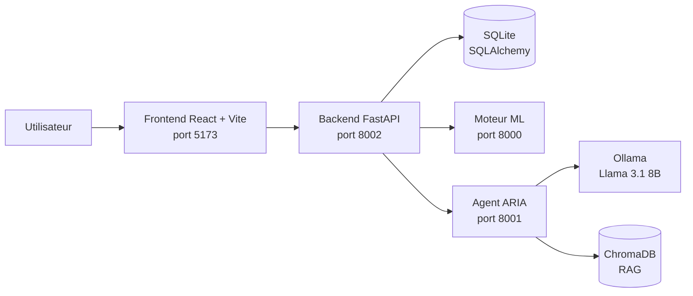

# ESPRIT Talents

Plateforme intelligente de gestion des talents du personnel enseignant d'ESPRIT.
Projet de fin d'études réalisé à **ESPRIT Tech** (mai – juillet 2026).

> **English summary.** Full-stack talent management platform built as a graduation project. It is split into three microservices: a hybrid NLP scoring engine (spaCy, Sentence-BERT, TF-IDF), a local LLM agent (Llama 3.1 8B via Ollama, RAG with ChromaDB, ReAct pattern) and a FastAPI backend (72 endpoints, JWT authentication, 15 roles), plus a React frontend. About 17,700 lines of code.

## Sommaire

- [Présentation](#présentation)
- [Architecture](#architecture)
- [Stack technique](#stack-technique)
- [Les trois services](#les-trois-services)
- [Installation et lancement](#installation-et-lancement)
- [Limites connues et pistes d'amélioration](#limites-connues-et-pistes-damélioration)
- [Auteur](#auteur)

## Présentation

ESPRIT Talents aide à évaluer les profils du personnel enseignant et à recommander des formations adaptées. La plateforme combine :

- un **moteur de scoring** qui extrait les informations d'un profil et le compare à des référentiels ;
- un **agent conversationnel, ARIA**, qui répond en langage naturel et appelle des outils métier ;
- une **API sécurisée** qui gère les utilisateurs, les rôles et les données ;
- une **interface web** pour les différents profils d'utilisateurs.

## Architecture



Trois microservices indépendants (moteur ML, agent ARIA, backend) communiquent par API REST. Le frontend ne parle qu'au backend, qui centralise l'authentification et l'accès aux données. Le chat en temps réel passe par WebSocket.

## Stack technique

| Domaine | Technologies |
|---|---|
| Backend | Python, FastAPI, SQLAlchemy, SQLite, JWT, WebSocket |
| Moteur ML | spaCy, RapidFuzz, TF-IDF, Sentence-BERT (`paraphrase-multilingual-MiniLM-L12-v2`) |
| Agent IA | Llama 3.1 8B (quantification Q4_K_M) via Ollama, ChromaDB, pattern ReAct |
| Frontend | React 18, Vite |

## Les trois services

### Moteur ML (port 8000)

Calcule un score d'adéquation en trois couches :

- extraction d'entités nommées avec **spaCy** ;
- similarité sémantique avec **Sentence-BERT** multilingue (embeddings de dimension 384) ;
- correspondance lexicale avec **TF-IDF**, **RapidFuzz** et des mots-clés.

La pondération est adaptative. Les poids de référence sont de 40 % pour Sentence-BERT, 35 % pour TF-IDF et 25 % pour les mots-clés.

### Agent ARIA (port 8001)

Agent conversationnel fonctionnant **en local** (aucune donnée envoyée à un service externe pour la génération).

- Modèle : Llama 3.1 8B quantifié Q4_K_M, servi par Ollama (température 0,3, fenêtre de contexte de 8192 tokens).
- **RAG** : base vectorielle ChromaDB alimentée par un corpus de connaissances.
- **Mémoire à 3 niveaux** pour garder le contexte des échanges.
- **Pattern ReAct** : l'agent raisonne, choisit un outil, observe le résultat, puis répond.
- **7 outils** : `generate_training_plan`, `evaluate_profile`, `recommend_formations`, `explain_talent_path`, `summarize_evaluations`, `search_knowledge`, `search_web`.

### Backend (port 8002)

- 15 routeurs FastAPI et **72 endpoints**.
- 13 tables gérées avec SQLAlchemy.
- Authentification **JWT** et **15 rôles** organisationnels.
- Chat temps réel par WebSocket.
- Jeu de données de test : 17 utilisateurs couvrant 10 rôles.

## Installation et lancement

### Prérequis

- Python `<version>` et pip
- Node.js `<version>` et npm
- [Ollama](https://ollama.com) installé, avec le modèle téléchargé :

```bash
ollama pull llama3.1:8b
```

### 1. Cloner le dépôt

```bash
git clone https://github.com/1bryane/<nom_du_depot>.git
cd <nom_du_depot>
```

### 2. Lancer les services

Chaque service tourne dans son propre terminal.

**Moteur ML (port 8000)**

```bash
cd <dossier_moteur_ml>
python -m venv .venv
source .venv/bin/activate        # Windows : .venv\Scripts\activate
pip install -r requirements.txt
python -m spacy download <modele_spacy>
uvicorn <module>:app --port 8000
```

**Agent ARIA (port 8001)**

```bash
cd <dossier_aria>
python -m venv .venv
source .venv/bin/activate
pip install -r requirements.txt
uvicorn <module>:app --port 8001
```

**Backend (port 8002)**

```bash
cd <dossier_backend>
python -m venv .venv
source .venv/bin/activate
pip install -r requirements.txt
cp .env.example .env             # puis renseigner les valeurs
uvicorn <module>:app --port 8002
```

**Frontend (port 5173)**

```bash
cd <dossier_frontend>
npm install
npm run dev
```

L'application est ensuite accessible sur http://localhost:5173.

### Comptes de test

Des utilisateurs fictifs sont créés par le script `/esprit-talents/backend/seed.py`. Aucune donnée réelle n'est incluse dans le dépôt.

## Limites connues et pistes d'amélioration

Ce projet est un prototype académique. Ses limites actuelles :

| Limite | Piste |
|---|---|
| Aucun test automatisé | Ajouter des tests (pytest côté Python, Vitest côté frontend) et une intégration continue |
| Base SQLite | Migrer vers PostgreSQL pour la concurrence et le déploiement |
| Corpus RAG réduit (22 passages indexés) | Élargir le corpus et mesurer la qualité des réponses |
| Lancement manuel de quatre services | Conteneuriser avec Docker et orchestrer avec docker-compose |
| Historique Git créé après le développement | Travailler par branches et commits atomiques pour la suite |

## Auteur

**Harold Bryane Lys Kouassivi AGBEMAVO**
Ingénieur data science (ESPRIT, 2026), master Data Engineering for AI (DSTI Paris)

- GitHub : [github.com/1bryane](https://github.com/1bryane)
- LinkedIn : [linkedin.com/in/harold-agbemavo](https://www.linkedin.com/in/harold-agbemavo)

## Licence

Projet académique réalisé à ESPRIT Tech. 
